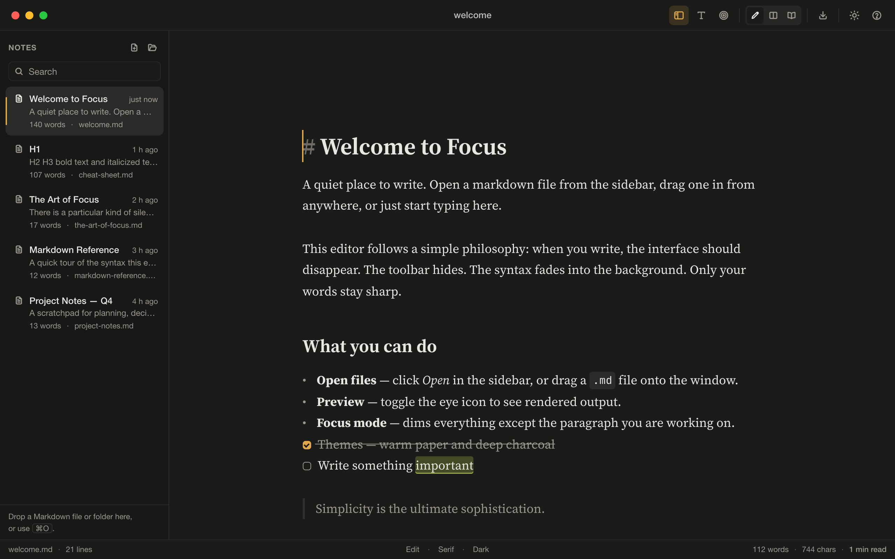

# Focus


A minimal, distraction-free Markdown editor for macOS (11 Big Sur or later), built with Tauri 2 (Rust) and CodeMirror 6.



## Download

macOS 11 or later. Unsigned builds — on first launch, right-click the app → **Open**.

- [Apple Silicon (DMG)](https://github.com/w2vasia/focus-app/releases/download/v0.1.0/Focus_0.1.0_aarch64.dmg)
- [Intel (DMG)](https://github.com/w2vasia/focus-app/releases/download/v0.1.0/Focus_0.1.0_x64.dmg)
- [All releases](https://github.com/w2vasia/focus-app/releases)

## Features

- **Live preview editing.** Markdown renders as you type; the syntax of the line you are editing stays visible.
- **Full Markdown support.** Every Basic and Extended item of the [Markdown Guide cheat sheet](https://www.markdownguide.org/cheat-sheet/): headings, emphasis, lists, task lists, links, images, code, tables, footnotes, heading IDs, definition lists, strikethrough, highlight, subscript, superscript and emoji.
- **Three views.** Edit, Split (needs a window at least 821 px wide) and Read.
- **Folder sidebar.** Lists the Markdown files in a folder with title, snippet, word count and age. Search, create, rename, move to Trash and Reveal in Finder. Updates when files change on disk. In windows 900 px wide or less it overlays the document; rest the pointer at the left edge to peek at it.
- **Formatting.** A selection bubble, an optional pinned formatting bar and the Format menu.
- **Focus mode.** Dims everything except the current paragraph or sentence. Optional typewriter scrolling.
- **Autosave.** Saves 0.6 s after you stop typing. Warns when the file changes or disappears on disk.
- **Export.** HTML and PDF (through the print dialog).
- **Word count and reading time** in the status bar.
- **Themes.** Light, dark or follow the system. Serif, sans or mono font. Adjustable text size.
- **Remote images** load only when clicked (no tracking pixels). Plain `http` images are never loaded.

Supported files: `.md`, `.markdown`, `.mdown`, `.txt`.

## Keyboard shortcuts

| Action | Shortcut |
|---|---|
| New / Open / Open Folder | ⌘N / ⌘O / ⇧⌘O |
| Save / Save As | ⌘S / ⇧⌘S |
| Export HTML / PDF | ⇧⌘E / ⌘P |
| Bold / Italic / Strikethrough / Highlight | ⌘B / ⌘I / ⇧⌘X / ⇧⌘H |
| Inline code / Link | ⌘E / ⌘K |
| Paragraph / Heading 1–3 | ⌘0 / ⌘1–⌘3 |
| Table / Code block | ⌥⌘T / ⌥⌘C |
| Toggle sidebar / Search library | ⌘\ / ⇧⌘L |
| Edit / Split / Read view | ⌥⌘1 / ⌥⌘2 / ⌥⌘3 |
| Focus mode / Typewriter scrolling | ⇧⌘F / ⇧⌘Y |
| Help | ⇧⌘/ |

The Format and View menus and the in-app Help list every shortcut.

## Requirements

- macOS 11 or later
- [Rust](https://rustup.rs) (stable) with `cargo` on `PATH` (`export PATH="$HOME/.cargo/bin:$PATH"`)
- Node.js 20.19+ or 22.12+ with npm
- Xcode Command Line Tools (`xcode-select --install`)

## Development

```sh
npm install
npm run tauri dev       # run the app with hot reload
```

Browser preview with a mocked backend (UI work only, no real files): `npx vite --port 1420`, then open <http://localhost:1420/dev/browser.html> (add `?theme=dark` for dark mode).

## Tests

```sh
npm test                                  # editor tests (TypeScript)
npx tsc --noEmit                          # type check
cd src-tauri && cargo test                # backend tests (Rust)
cd src-tauri && cargo clippy --all-targets -- -D warnings
```

## Build

```sh
npm run tauri build
```

Output in `src-tauri/target/release/bundle/`:

- `macos/Focus.app`
- `dmg/Focus_<version>_aarch64.dmg`

The default build targets the Mac it is built on. For Apple Silicon and Intel in one app:

```sh
rustup target add x86_64-apple-darwin aarch64-apple-darwin
npm run tauri build -- --target universal-apple-darwin
```

Builds are unsigned. Other Macs will block the app until it is opened with right-click → Open. To sign and notarize, set `APPLE_SIGNING_IDENTITY`, `APPLE_ID`, `APPLE_PASSWORD` and `APPLE_TEAM_ID` before building.

## Project layout

```
src/                 Frontend (TypeScript, no framework)
  main.ts            App controller: open, save, conflicts, quit, views
  editor/            CodeMirror setup, live preview, tables, commands, focus mode
  ui/                Sidebar, selection bubble, toolbar, help, status bar, icons
  styles/            chrome.css (UI and colour tokens), theme.css (editor, print)
src-tauri/src/       Backend (Rust)
  scope.rs           File access allowlist
  files.rs           Read, atomic write, rename, trash, folder scan, file watching
  export.rs          Markdown → HTML (comrak), PDF printing
  settings.rs        Validated settings storage
  dialogs.rs, menu.rs, lib.rs
tests/               Editor tests (run with tsx)
dev/                 Browser preview harness, design review screenshots, logo concepts
TODO.md              Review findings and their status
```

## Security model

The web view is treated as untrusted. The Rust backend only reads and writes:

- files and folders the user picked in an Open/Save dialog, opened from Finder or dropped on the window;
- Markdown files inside those folders, excluding hidden entries and `~/Library`;
- an HTML export only at the exact path picked in the Export dialog, once.

Folder renames are refused for the library folder itself, the home folder and its direct children, `~/Library`, and Focus's own data folders. Saves use an atomic write and are refused if another app changed the file since it was loaded.

## Data

Stored in `~/Library/Application Support/com.focus.editor/`:

- `settings.json`: preferences, last folder and last file
- `scope.json`: the folders and files Focus is allowed to access

## Status

Version 0.1.0. Open review findings are listed in `TODO.md`.
